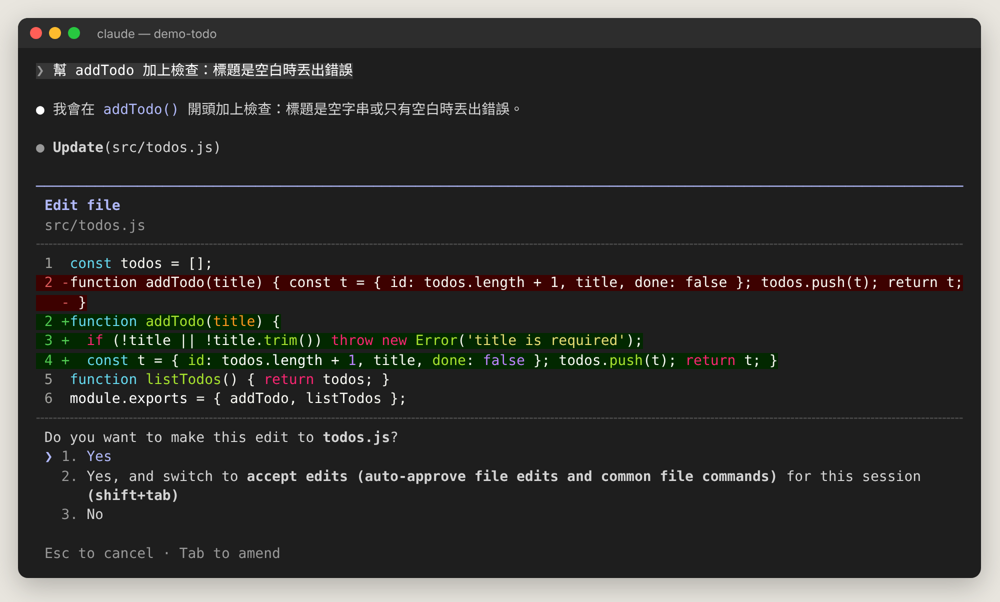

# Claude Code 完全新手教學（第二版・繁體中文）

> 給**完全沒用過** Claude Code 的人看的教學：從「什麼是 session」講起，到設定面板每一個選項、`settings.json` 全部 245 個設定項目，都附說明與例子；重要畫面都有真實截圖。

- 📅 資料截至：**2026/10/29**
- 🔖 版本基準：**Claude Code v2.1.312**，預設模型 Claude Opus 5.5
- 🖼️ 截圖：真實的 Claude Code v2.1.312 終端機畫面（在示範專案 `demo-todo` 中操作）
- 🌐 網頁版：開啟 GitHub Pages 後，可直接看單頁網頁版（`index.html`，含搜尋、深色模式、閱讀進度）

## 目錄

| 章 | 內容 |
| --- | --- |
| 01 | [先搞懂基本觀念（給完全新手）](docs/01-basics.md) |
| 02 | [Chat 與 Code 差在哪？Claude 有哪些用法？](docs/02-chat-vs-code.md) |
| 03 | [安裝、登入與第一次啟動](docs/03-install.md) |
| 04 | [手把手：你的第一個 Claude Code 工作流程](docs/04-first-session.md) |
| 05 | [介面導覽與快捷鍵](docs/05-interface.md) |
| 06 | [斜線指令大全](docs/06-commands.md) |
| 07 | [`/config` 設定面板：每個選項逐一說明](docs/07-config-panel.md) |
| 08 | [settings.json：所有設定項目逐一說明](docs/08-settings-json.md) |
| 09 | [權限、Auto mode 與沙盒](docs/09-permissions.md) |
| 10 | [模型、推理強度、Fast mode 與 Context 管理](docs/10-models.md) |
| 11 | [記憶：CLAUDE.md、Rules、AGENTS.md 與自動記憶](docs/11-memory.md) |
| 12 | [擴充 Claude Code：Skills、Subagents、Hooks、MCP、Plugins、Mods](docs/12-extend.md) |
| 13 | [進階：平行工作、自動化、雲端與程式碼審查](docs/13-advanced.md) |
| 14 | [命令列參數與環境變數](docs/14-cli-env.md) |
| 15 | [疑難排解、最佳實踐與新功能時間軸](docs/15-faq.md) |

## 建議閱讀順序

1. **完全新手**：第 1 → 2 → 3 → 4 → 5 章，跟著做一遍。
2. **開始日常使用**：第 7 章（設定面板）、第 9 章（權限）、第 11 章（CLAUDE.md）。
3. **想客製化**：第 8 章（所有設定）、第 12 章（Skills、Hooks、MCP…）。
4. **進階**：第 10、13、14 章。
5. **遇到問題**：第 15 章。

## 關於截圖

Claude 桌面 App 無法被自動化工具操作，因此本教學截圖皆擷取自同版本的 Claude Code 終端機介面。桌面版 Code 分頁使用同一套引擎，對話、權限詢問、差異顯示的內容與這些畫面一致；桌面版特有的介面元素在第 2 章以文字說明。

## 授權與來源

內容整理自 [Claude Code 官方文件](https://code.claude.com/docs/en/overview) 與 changelog。Claude Code 更新非常頻繁，若與你的版本不符，請以 `/release-notes` 與官方文件為準。
