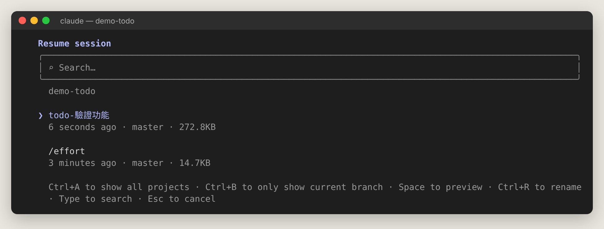
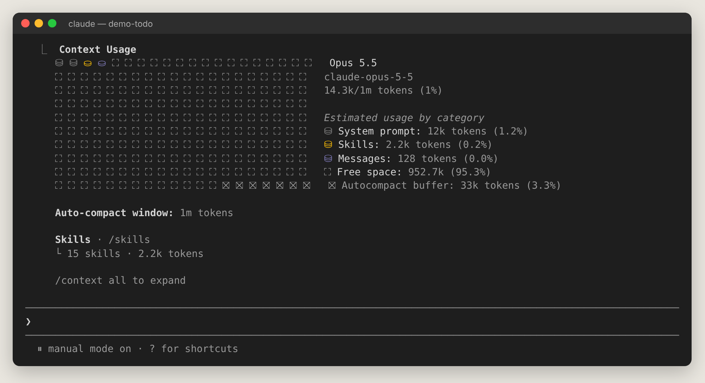

# 第 1 章　先搞懂基本觀念（給完全新手）

> 這一章不需要動手，只要讀懂。後面所有操作都建立在這些觀念上。讀完你會知道「session、context、token、工具、權限、模型」這些詞在講什麼。

## 1.1 Claude 是什麼？Claude Code 又是什麼？

**Claude** 是 Anthropic 公司開發的 AI 助手。你可以把它想成一位很聰明、讀過大量資料、會寫程式也會寫文章的同事。

**Claude Code** 是「讓 Claude 直接在你的電腦上幫你寫程式」的工具。一般的聊天 AI 只能**回答**你，你還得自己把程式碼複製貼上；Claude Code 則可以：

- 自己打開、閱讀你專案裡的檔案
- 直接修改程式碼
- 在終端機執行指令（安裝套件、跑測試、啟動伺服器）
- 使用 git（看差異、建立分支、commit）
- 上網查文件

這種「會自己動手做事」的 AI，叫做 **AI 代理（agent）**。

> 💡 **比喻**：一般聊天 AI 像是「電話另一頭的顧問」，只能口頭建議；Claude Code 像是「坐在你旁邊、可以用你電腦的實習工程師」，會實際操作，但重要動作會先問你。

## 1.2 Claude Code 怎麼工作？——「代理迴圈」

你下一個指令後，Claude Code 會重複這個循環，直到任務完成：

```
你的需求 → Claude 思考下一步 → 呼叫工具（讀檔／改檔／跑指令）
       → 看工具的結果 → 再思考 → …… → 回報結果給你
```

下圖是真實畫面：我們問「這個專案在做什麼？」，Claude 先說要讀檔（`Read 2 files`），讀完後才回答。


按 <kbd>Ctrl+O</kbd> 可以看到每一步的細節（讀了哪個檔、讀了幾行）：


## 1.3 Session（工作階段）是什麼？

**Session = 一段連續的對話**，包含你說過的話、Claude 的回覆、它做過的所有動作。

| 你可以這樣想 | 說明 |
| --- | --- |
| 一個 session 就像一本「工作筆記本」 | 從你輸入 `claude` 開始，到你離開或 `/clear` 為止，都寫在同一本 |
| 每次 `claude` 都會開一本新筆記本 | 舊筆記本會保存在電腦裡（預設 30 天），可以用 `/resume` 或 `claude -c` 翻回來 |
| 同一個資料夾可以有很多本 | 例如「修登入 bug」一本、「寫新功能」一本，互不干擾 |

常用的 session 操作：

| 想做的事 | 怎麼做 |
| --- | --- |
| 開始新 session | 在專案資料夾輸入 `claude` |
| 回到最近一次的對話 | `claude -c`（continue） |
| 從清單挑一個舊對話 | `claude -r` 或在 session 中輸入 `/resume` |
| 幫 session 取名字 | `/rename 登入功能`，之後 `claude -r 登入功能` 就能找回 |
| 換一個新任務、清空對話 | `/clear`（舊對話仍可 `/resume` 找回） |
| 從某一點分岔出另一條路 | `/branch` |

下圖是 `/resume` 的選單，可以看到之前的 session（含名稱、時間、git 分支、大小）：



> 📌 **重點**：Claude 在新 session 中**不會記得**上一個 session 的對話內容。要讓它「每次都知道」的事，請寫進 `CLAUDE.md`（第 11 章）。

## 1.4 回合（Turn）

你送出一則訊息，到 Claude 回覆完畢並停下來等你，叫做**一個回合**。一個回合裡 Claude 可能會呼叫好幾次工具。回合結束時你會看到類似 `✻ Crunched for 12s` 的耗時提示。

在 Claude 工作中，你仍然可以繼續輸入，訊息會**排隊**，等這個回合結束再送出；要立刻打斷，按 <kbd>Esc</kbd>。

## 1.5 Context（上下文）與 Context window（上下文視窗）

**Context** 是 Claude「此刻腦中能看到的所有東西」：系統說明、你的 CLAUDE.md、對話歷史、讀過的檔案內容、指令輸出……

**Context window** 是這個容量的上限。目前 Claude 的主力模型有 **100 萬 token** 的視窗。

> 💡 **比喻**：context window 像一張辦公桌。桌子很大，但東西堆太多，重要文件就容易被淹沒，Claude 的表現也會下降；而且桌上東西越多，每次「看一遍」的成本也越高。

用 `/context` 可以看到桌上目前放了什麼、還剩多少空間：



當 context 快滿時，Claude Code 會**自動壓縮（auto-compact）**：把較早的對話摘要成短短一段，騰出空間。你也可以手動 `/compact`。

## 1.6 Token 是什麼？

**Token** 是 AI 計算文字量的單位，大約是：英文 1 個單字 ≈ 1～1.3 token；中文 1 個字 ≈ 1～2 token。

Token 和兩件事有關：

1. **容量**：context window 以 token 計算。
2. **費用／額度**：用 API 付費是依 token 計價（例如 Opus 5.5 每百萬輸入 token 4 美元）；用訂閱方案則是消耗你的 5 小時與每週用量額度。

`/usage` 可以看本次花費與方案額度：


## 1.7 工具（Tools）

Claude 本身只會「想」和「說」，要動手就得透過**工具**。常見工具：

| 工具 | 做什麼 | 需要權限嗎 |
| --- | --- | --- |
| Read | 讀取檔案 | 通常不用 |
| Glob／Grep | 找檔案、搜尋文字 | 通常不用 |
| Edit／Write | 修改／建立檔案 | 預設要問你 |
| Bash（Windows 為 PowerShell） | 執行終端機指令 | 預設要問你 |
| WebFetch／WebSearch | 讀網頁、搜尋網路 | 視網站而定 |
| Agent | 派一個「子代理」去做子任務 | 視情況 |

## 1.8 權限（Permissions）：Claude 什麼時候會先問你？

因為 Claude 能改你的檔案、跑指令，所以有**權限系統**保護你。當它要做有風險的事，會跳出確認框：


上圖中紅色是要刪除的行、綠色是要新增的行。你可以選：

- **1. Yes**：只允許這一次
- **2. Yes, and switch to accept edits**：這個 session 之後的修改都自動允許
- **3. No**：拒絕（可以再告訴 Claude 你想怎麼改）

要跑指令時也一樣：


「Yes, and don't ask again for: npm test *」會把這條規則記住，以後同類指令不再問。

**權限模式**決定「問的頻率」，按 <kbd>Shift+Tab</kbd> 切換（第 9 章詳解）：

| 模式 | 一句話說明 | 適合 |
| --- | --- | --- |
| Manual（手動） | 除了讀取，什麼都先問 | 剛開始用、重要專案 |
| Accept edits（自動接受編輯） | 改檔不問，跑指令會問 | 信任方向、想快一點 |
| Plan（規劃） | 只研究不修改，先給你計畫 | 大改動之前 |
| Auto（自動） | 由安全分類器把關，低風險直接做、高風險擋下 | 目前互動模式的預設 |

## 1.9 模型（Model）與推理強度（Effort）

- **模型**是 Claude 的「大腦型號」。目前有 Opus 5.5（預設，聰明且相對便宜）、Sonnet 5.5（快又便宜）、Haiku 5.5（最快最便宜）、Fable 5.1（最強也最貴，需權限）。用 `/model` 切換。
- **Effort** 是「這次要想多深」：low → medium → high → xhigh → max。越高越仔細但越慢、越耗額度。Opus 5.5 預設 medium。用 `/effort` 調整。


## 1.10 CLAUDE.md：給 Claude 的「專案說明書」

每次開新 session，Claude 都是「第一天上班」。`CLAUDE.md` 是放在專案根目錄的 Markdown 檔，Claude 每次啟動都會先讀，就像新同事的入職手冊。裡面寫：怎麼安裝、怎麼跑測試、程式風格、哪些檔案不能動……

輸入 `/init` 讓 Claude 自動幫你產生第一版。詳見第 11 章。

## 1.11 檢查點（Checkpoint）與回溯（Rewind）

Claude 每次改檔前都會自動存檔。改壞了？在空白輸入框連按兩下 <kbd>Esc</kbd>（或輸入 `/rewind`），選擇要回到哪一步：


> ⚠️ 用 Bash 指令改的檔案（例如 `sed -i`、`rm`）不在檢查點裡，無法還原。重要專案請搭配 git 使用。

## 1.12 名詞速查表

| 名詞 | 白話解釋 |
| --- | --- |
| Session | 一段連續對話（一本筆記本） |
| Turn（回合） | 你說一次 → Claude 做完一次 |
| Context | Claude 此刻看得到的全部內容 |
| Context window | Context 的容量上限 |
| Token | 計算文字量與費用的單位 |
| Compact（壓縮） | 把舊對話摘要以騰出空間 |
| Tool（工具） | Claude 動手做事的方法（讀檔、改檔、跑指令） |
| Permission mode | 決定 Claude 何時要先問你 |
| Model | Claude 的大腦型號 |
| Effort | 這次要想多深 |
| CLAUDE.md | 專案說明書，每次自動讀 |
| Skill | 可重複使用的專業流程說明書（`/名稱` 呼叫） |
| Subagent（子代理） | Claude 派出去做子任務的分身 |
| Hook | 在特定時機自動執行的腳本 |
| MCP | 讓 Claude 連到外部工具（GitHub、資料庫…）的標準 |
| Plugin | 把以上擴充功能打包分享的套件 |
| Worktree | git 的「同一個 repo 開多個工作資料夾」功能，讓多個 Claude 平行工作不互相干擾 |
