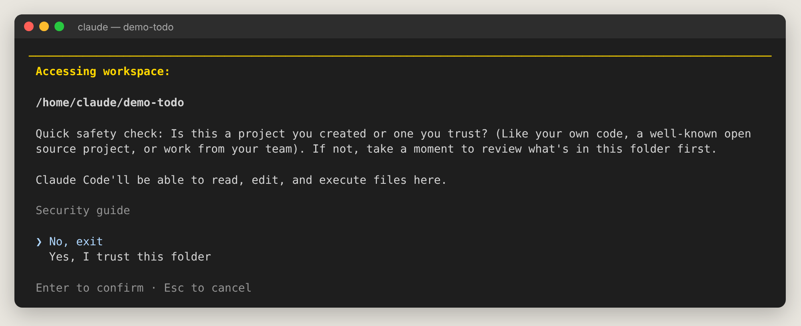
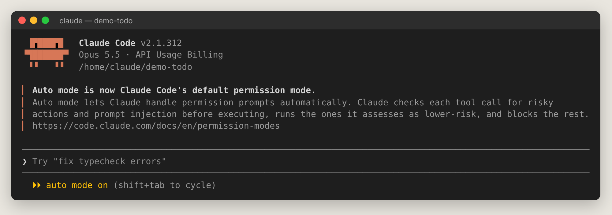

# 第 3 章　安裝、登入與第一次啟動

## 3.1 終端機 30 秒入門

Claude Code 主要在**終端機**中使用。你只需要會三件事：

| 指令 | 作用 | 例子 |
| --- | --- | --- |
| `cd 路徑` | 進入某個資料夾 | `cd ~/projects/my-app`（Windows：`cd C:\Users\你\projects\my-app`） |
| `ls`（Windows PowerShell 也可用 `dir`） | 列出目前資料夾內容 | `ls` |
| `pwd` | 顯示目前在哪個資料夾 | `pwd` |

開啟方式：macOS 按 <kbd>Cmd+Space</kbd> 搜尋「終端機」；Windows 按 <kbd>Win</kbd> 搜尋「PowerShell」或「Terminal」。

> 💡 不想用終端機？可以直接用 Claude 桌面版的 **Code** 分頁（第 2 章），概念完全相同。

## 3.2 安裝

需要：一個 Claude 訂閱（Pro／Max／Team／Enterprise）或 Claude Console 帳號。

**macOS／Linux／WSL：**

```bash
curl -fsSL https://claude.ai/install.sh | bash
```

**Windows PowerShell（提示字元是 `PS C:\>`）：**

```powershell
irm https://claude.ai/install.ps1 | iex
```

**Windows CMD（提示字元是 `C:\>`）：**

```batch
curl -fsSL https://claude.ai/install.cmd -o install.cmd && install.cmd && del install.cmd
```

> 原生安裝版會在背景**自動更新**。也可用 `brew install --cask claude-code`（macOS）或 `winget install Anthropic.ClaudeCode`（Windows），但這兩種不會自動更新。

裝好後**開一個新的終端機視窗**，確認版本：

```bash
claude --version
# 2.1.312 (Claude Code)
```

Windows 建議另外安裝 [Git for Windows](https://git-scm.com/downloads/win)，Claude 才能使用 Bash 工具；沒裝的話會改用 PowerShell。

### 常見安裝問題

| 狀況 | 解法 |
| --- | --- |
| `claude: command not found` | 關掉終端機重開；仍不行請依官方「Troubleshoot installation」把安裝路徑加入 PATH |
| `'irm' is not recognized` | 你在 CMD，請改用 CMD 的那行指令或打開 PowerShell |
| `The token '&&' is not a valid statement separator` | 你在 PowerShell，請改用 PowerShell 的那行 |

## 3.3 第一次啟動

```bash
cd 你的專案資料夾
claude
```

第一次會引導你在瀏覽器登入。登入方式：

- **Claude 訂閱**（推薦）：用量含在月費。
- **Claude Console**：API 預付，依用量計費。
- **公司的雲端供應商**（Bedrock、Vertex、Foundry）或公司閘道：依公司指示。

### 信任資料夾

在一個新資料夾第一次啟動時，會問你是否信任這個資料夾：



選 **Yes, I trust this folder**。只有你自己的專案、知名開源專案或團隊專案才該信任；陌生人給的資料夾請先檢查內容（裡面的設定檔可能讓 Claude 執行指令）。

### 主畫面



| 區域 | 說明 |
| --- | --- |
| 左上 Logo 旁 | 版本、目前模型（Opus 5.5）、帳號類型、工作資料夾 |
| 中間 | 對話區（目前顯示 Auto mode 已成為預設的說明） |
| `◐ medium · /effort` | 目前推理強度，可用 `/effort` 調整 |
| `❯` 輸入框 | 在這裡打字；灰色字是建議範例 |
| 最下方狀態列 | 目前權限模式（`⏵⏵ auto mode on`）與提示（`shift+tab to cycle`、`← for agents`） |

## 3.4 更新與版本

| 想做的事 | 指令 |
| --- | --- |
| 手動更新到最新版 | `claude update` |
| 查看新版本有什麼 | session 中輸入 `/release-notes` |
| 改用較穩定的頻道 | `/config` → Auto-update channel → stable |
| 安裝特定版本 | `claude install 2.1.300` |
| 診斷安裝問題 | `claude doctor`（終端機）或 `/doctor`（session 中） |

## 3.5 從其他 AI 工具搬家

用過 Codex、Gemini CLI 或 Cursor？可以一鍵匯入它們的設定（指示檔、MCP、指令、subagent、skills）：

```bash
claude import cursor --dry-run   # 先預覽
/import codex                    # 在 session 中匯入
```
