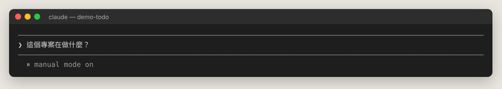
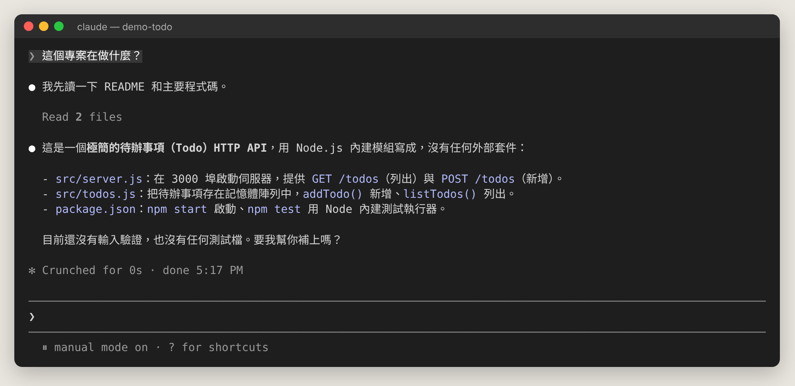
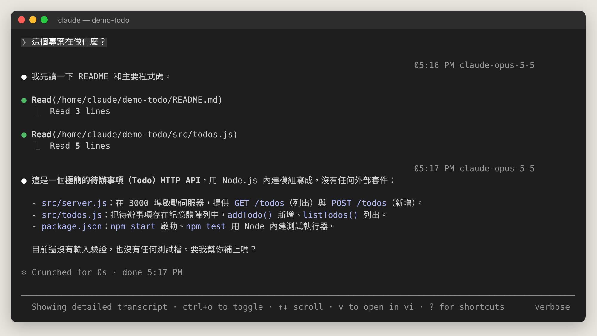
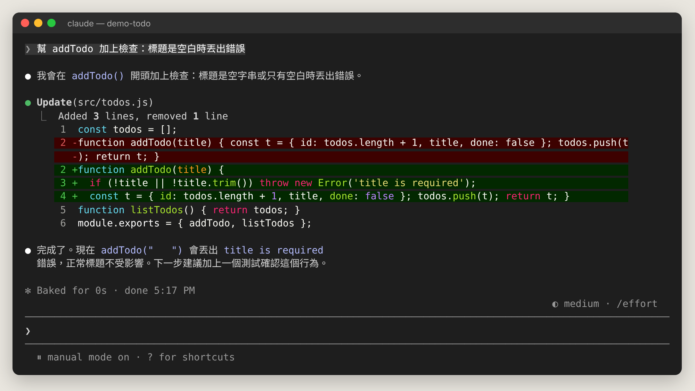
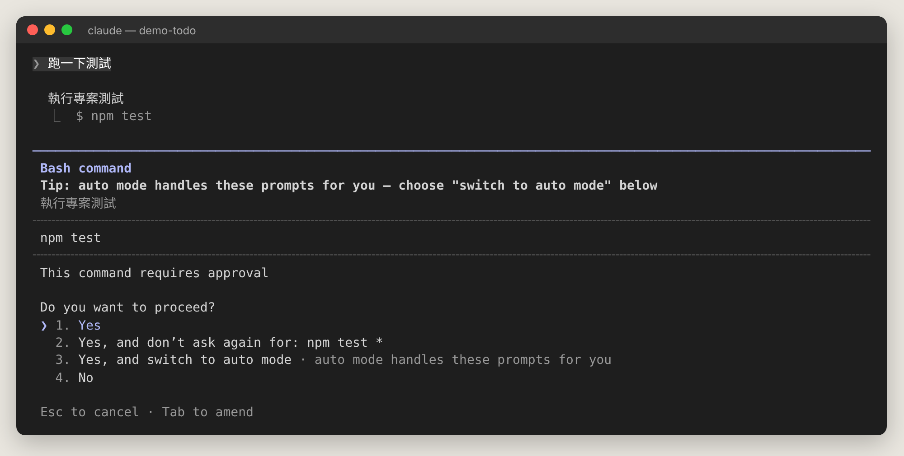
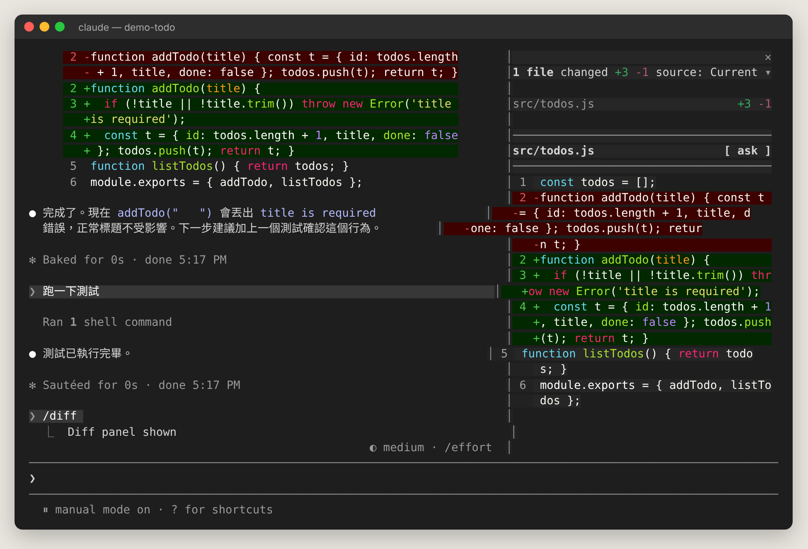
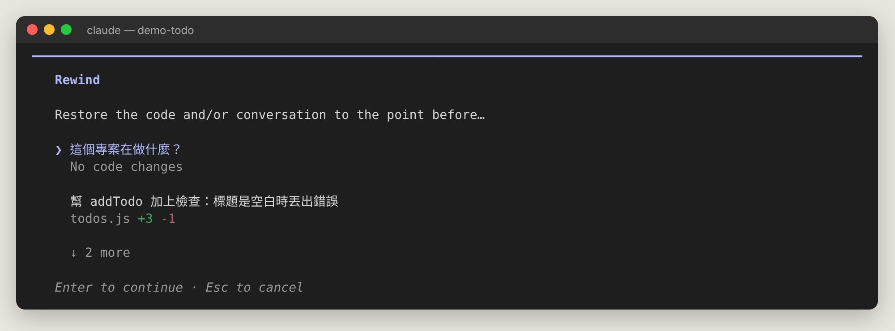
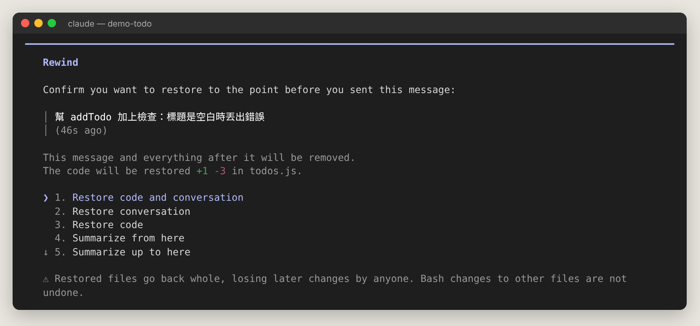

# 第 4 章　手把手：你的第一個 Claude Code 工作流程

> 本章用一個小小的待辦事項 API 專案（`demo-todo`）示範從「看懂專案」到「修改、測試、檢查、回溯」的完整流程。所有截圖都是真實畫面。

## 4.1 準備：建立 CLAUDE.md

進入專案後，第一件事建議執行：

```
/init
```

Claude 會分析專案並產生 `CLAUDE.md`（專案說明書），裡面記錄建置指令、測試方式、程式風格。以後每次開 session 都會自動讀它。

## 4.2 第一步：先讓 Claude 讀懂專案

在輸入框打字（中文完全沒問題）：



按 <kbd>Enter</kbd> 送出。Claude 會先讀檔，再回答：



看到 `Read 2 files` 代表它讀了兩個檔案。想看細節就按 <kbd>Ctrl+O</kbd>：



> 💡 **新手技巧**：在要它改東西之前，先讓它「讀、解釋」。它理解得越正確，後面改得越好。

## 4.3 第二步：請它修改程式


這是最重要的一個畫面，請仔細看：

1. `● Update(src/todos.js)`：Claude 要修改哪個檔案。
2. 中間的差異：**紅色 `-`** 是要刪掉的行、**綠色 `+`** 是要加上的行。
3. 底部選項：
   - **1. Yes**：同意這次修改。
   - **2. Yes, and switch to accept edits**：之後這個 session 的修改都不再問。
   - **3. No**：拒絕。拒絕後可以直接告訴它你要怎麼改。
   - <kbd>Tab</kbd>（Tab to amend）：同意的同時附上一段補充說明。

選 Yes 後，Claude 完成修改並說明：



## 4.4 第三步：讓它跑指令



執行指令前同樣會詢問。選項 **2. Yes, and don't ask again for: npm test \*** 會記住這條規則（寫進 `.claude/settings.local.json`），以後跑測試不再問。

## 4.5 第四步：檢查改了什麼

輸入 `/diff` 看所有改動（含 Claude 改的）：



## 4.6 改壞了？回到過去

在**空白**輸入框按兩下 <kbd>Esc</kbd>，或輸入 `/rewind`：



每則訊息旁顯示該點之後的程式改動（例如 `todos.js +3 -1`）。選一則按 Enter：



| 選項 | 效果 |
| --- | --- |
| Restore code and conversation | 程式碼與對話都回到那一刻 |
| Restore conversation | 只回溯對話，程式碼保留 |
| Restore code | 只還原程式碼，對話保留 |
| Summarize from here／up to here | 不刪除，而是把那段之後／之前的對話摘要壓縮 |

## 4.7 第五步：收尾

- 讓 Claude 幫你 commit：「幫我寫一個清楚的 commit 訊息並 commit」。
- 換下一個不相關的任務前輸入 `/clear` 開新對話（舊的可用 `/resume` 找回）。
- 給 session 取名：`/rename todo-驗證功能`。

## 4.8 推薦工作節奏

```
① 探索：「先讀相關檔案，解釋一下現在怎麼運作，先不要改」
② 計畫：Shift+Tab 切到 Plan 模式，或輸入 /plan 加任務描述
③ 實作：核准計畫後讓它動手
④ 驗證：跑測試、/code-review、/verify
⑤ 檢查：/diff 看過再 commit
```

## 4.9 寫出好提示的技巧

| ❌ 模糊 | ✅ 具體 |
| --- | --- |
| 修 bug | 輸入錯誤密碼後畫面變空白，請找出原因並修好，修完跑 `npm test` 確認 |
| 加測試 | 幫 `src/todos.js` 的 `addTodo` 寫單元測試，包含空白標題的情況 |
| 改好看一點 | 把首頁按鈕改成圓角、主色 #c2562f，手機版寬度 100% |

原則：**說清楚目標、限制、怎麼驗證完成**。大任務拆成條列步驟。可以貼截圖（<kbd>Ctrl+V</kbd>）或用 `@檔名` 指定檔案。
