# 第 5 章　介面導覽與快捷鍵

## 5.1 輸入框的四個「魔法開頭」

| 開頭 | 作用 | 例子 |
| --- | --- | --- |
| `/` | 指令或 skill 選單 | `/help`、`/model`、`/clear` |
| `!` | 直接執行終端機指令，輸出會加入對話 | `! git status` |
| `@` | 指定檔案或資料夾（自動完成） | `看一下 @src/todos.js` |
| `?`（空白時） | 顯示快捷鍵說明 | — |

**輸入 `/` 的指令選單**（繼續打字可篩選）：

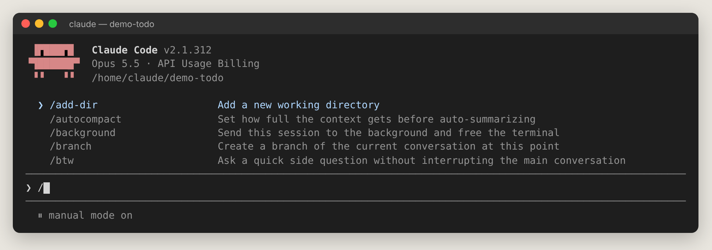

**`!` 進入 shell 模式**，輸入框左側變成 `!`、底部顯示 `! for shell mode`：

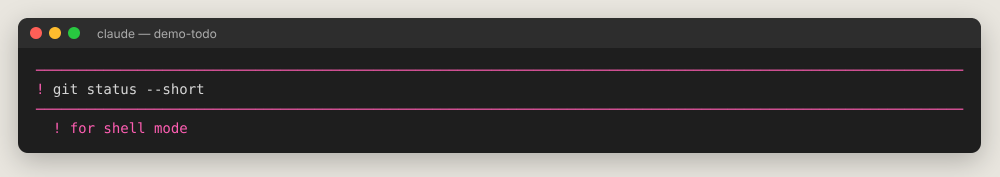

**`@` 提及檔案**，會跳出路徑建議，按 <kbd>Tab</kbd> 接受：

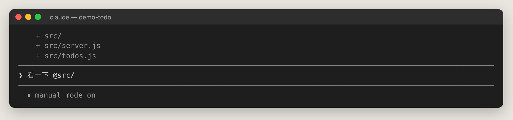

**`?` 顯示快捷鍵**：

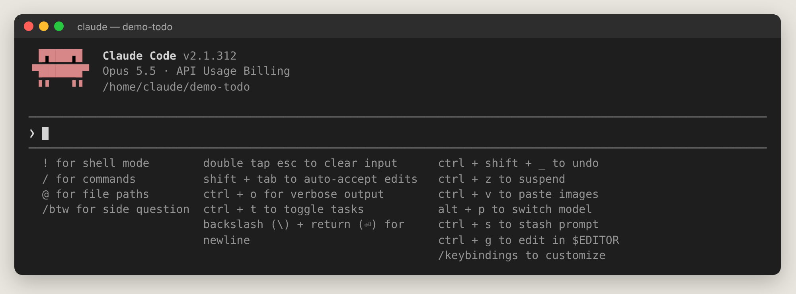

## 5.2 權限模式指示（畫面最下方）

按 <kbd>Shift+Tab</kbd> 循環切換，最下方會即時顯示目前模式：

**Manual（手動）**——除了讀取都會問你：

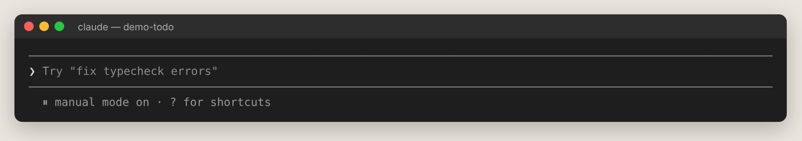

**Accept edits（自動接受編輯）**——改檔不問：

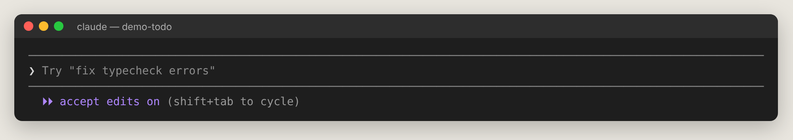

**Plan（規劃）**——只研究、先出計畫：

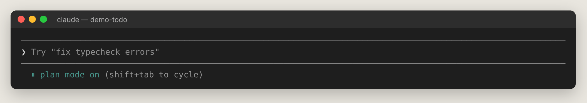

**Auto（自動）**——分類器把關，目前的預設：

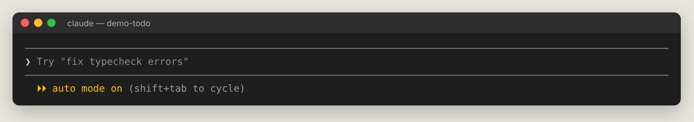

## 5.3 最常用的快捷鍵

| 按鍵 | 功能 | 新手何時用 |
| --- | --- | --- |
| <kbd>Enter</kbd> | 送出 | 每次 |
| <kbd>\\</kbd> + <kbd>Enter</kbd> | 換行（不送出） | 打多行訊息；執行 `/terminal-setup` 後可用 <kbd>Shift+Enter</kbd> |
| <kbd>Esc</kbd> | 中斷 Claude 目前的動作 | 發現方向不對時，立刻停 |
| <kbd>Esc</kbd> <kbd>Esc</kbd> | 有字時清空輸入；空白時開 Rewind | 改壞了想回去 |
| <kbd>Shift+Tab</kbd> | 切換權限模式 | 想先規劃或加快速度 |
| <kbd>↑</kbd> / <kbd>↓</kbd> | 叫出之前輸入過的訊息 | 重送或修改上一句 |
| <kbd>Ctrl+C</kbd> | 中斷；空白時按兩次離開 | 結束 Claude Code |
| <kbd>Ctrl+D</kbd> ×2 | 離開 | 結束 |
| <kbd>Ctrl+O</kbd> | 顯示詳細過程（transcript） | 想知道它讀了什麼、跑了什麼 |
| <kbd>Ctrl+T</kbd> | 顯示／隱藏 Claude 的待辦清單 | 長任務追進度 |
| <kbd>Ctrl+B</kbd> | 把正在跑的指令或子代理丟到背景 | 跑很久的伺服器、測試 |
| <kbd>Ctrl+G</kbd> | 用外部編輯器寫長訊息 | 要貼很長的需求 |
| <kbd>Ctrl+R</kbd> | 搜尋輸入歷史 | 找以前下過的指令 |
| <kbd>Ctrl+S</kbd> | 暫存目前草稿，再按一次還原 | 臨時插問一個問題 |
| <kbd>Ctrl+V</kbd>（Windows 也可 <kbd>Alt+V</kbd>） | 貼上圖片 | 貼錯誤截圖、設計稿 |
| <kbd>Ctrl+L</kbd> | 重繪畫面 | 畫面亂掉 |
| <kbd>Alt+P</kbd>（Mac：<kbd>Option+P</kbd>） | 切換模型 | — |
| <kbd>Alt+O</kbd>（Mac：<kbd>Option+O</kbd>） | 切換 Fast mode | — |
| <kbd>←</kbd>（空白時） | 把 session 放到背景並打開 Agent view | 想同時開好幾個任務 |
| <kbd>Ctrl+Z</kbd> | 暫停（macOS/Linux，用 `fg` 回來） | — |

> macOS 使用者：要用 <kbd>Option</kbd> 系列快捷鍵，請在終端機設定中開啟「Option 當作 Meta 鍵」。

## 5.4 好用的互動功能

- **訊息排隊**：Claude 工作中你可以繼續打字送出，訊息會排隊；按 <kbd>Ctrl+Enter</kbd> 立刻插隊送出。
- **`/btw 問題`**：問一個不會進入對話歷史的旁支問題，例如「/btw 這個 API 的英文全名是什麼？」。
- **`/help`**：說明頁，有 General、Commands、Custom commands 分頁：

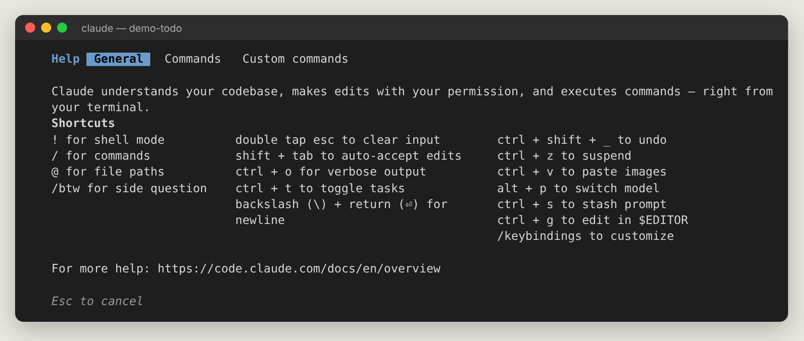

- **Session recap**：離開 5 分鐘以上回來，會顯示期間發生了什麼；也可 `/recap` 手動產生。
- **全螢幕模式**：`/tui fullscreen` 啟用不閃爍介面；在其中 `/focus` 只顯示重點。
- **Vim 模式**：`/config` → Editor mode 改成 vim。
- **語音輸入**：`/voice`（需 claude.ai 帳號）。

## 5.5 Agent view：同時管理多個 Claude

在空白輸入框按 <kbd>←</kbd>，目前對話會移到背景，並打開 Agent view：

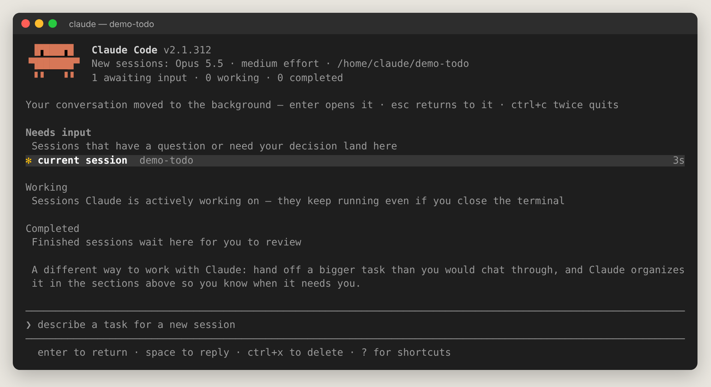

- **Needs input**：等你回答的 session
- **Working**：正在工作中（關掉終端機也會繼續跑）
- **Completed**：完成待你檢查
- 最下面輸入框直接描述新任務，就會開一個新的背景 session；<kbd>Enter</kbd> 進入某個 session、<kbd>Space</kbd> 快速預覽並回覆。

詳見第 13 章。

## 5.6 背景工作與 `/tasks`

`/tasks` 列出本 session 在背景跑的指令與子代理：

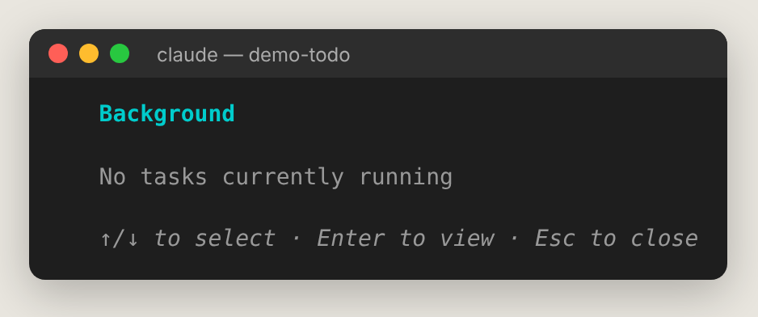
