# 第 7 章　`/config` 設定面板：每個選項逐一說明

> 在 Claude Code 中輸入 `/config`（或 `/settings`）就會打開設定面板。這章把面板上**每一個選項**都說明清楚，並告訴你對應的 `settings.json` 寫法。

## 7.1 面板長什麼樣子

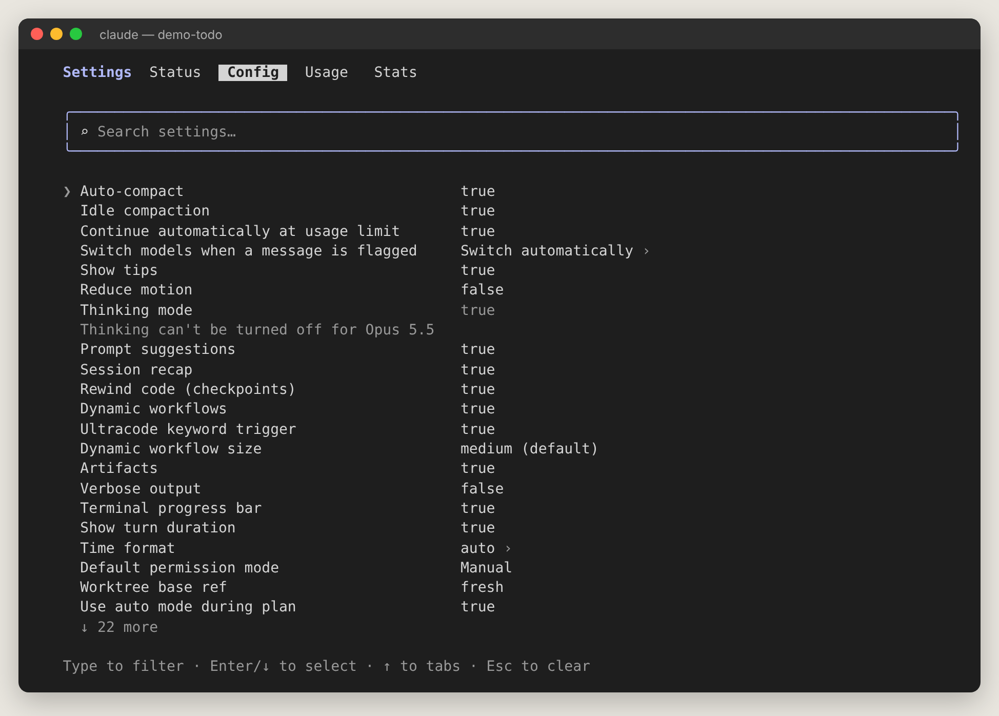

最上方有五個分頁：

| 分頁 | 內容 |
| --- | --- |
| **Settings** | 標題（目前所在的設定面板） |
| **Status** | 版本、session、模型、帳號、已載入的設定來源 |
| **Config** | 所有可調整的選項（本章重點） |
| **Usage** | 本次 session 成本、方案額度 |
| **Stats** | 使用統計 |

**操作方式**：

- 一打開游標在搜尋框，直接打字就能篩選選項（例如輸入 `theme`）。
- <kbd>↓</kbd> 進入清單，<kbd>Enter</kbd> 或 <kbd>Space</kbd> 切換 true/false 或打開子選單（有 `›` 的項目）。
- <kbd>↑</kbd> 回到分頁列，<kbd>←</kbd>/<kbd>→</kbd> 切換分頁，<kbd>Esc</kbd> 關閉。
- 也可以不開面板，直接輸入 `/config 選項=值`，例如 `/config verbose=true`。`/config --help` 列出可用的選項名稱。

搜尋篩選的樣子：

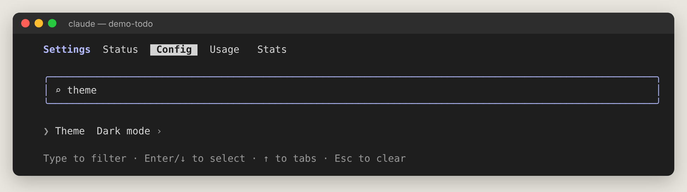

**完整清單（v2.1.312）**：

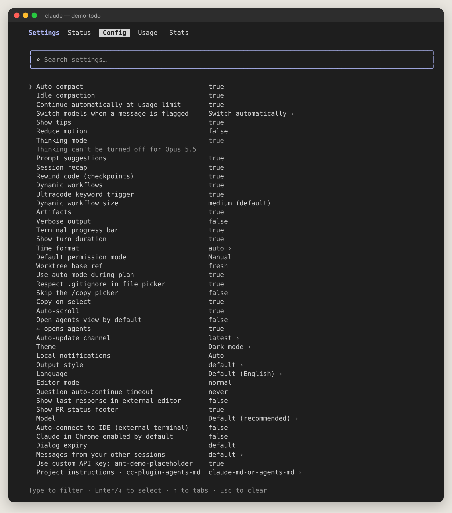

> 你在面板上的變更大多存到 `~/.claude/settings.json`（對所有專案生效）；少數（例如 Show tips）存到專案的 `.claude/settings.local.json`；少數全域選項存到 `~/.claude.json`。

## 7.2 Status 與 Usage 分頁

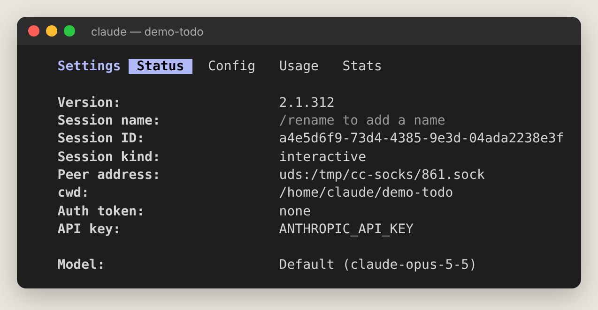

| 欄位 | 意思 |
| --- | --- |
| Version | Claude Code 版本 |
| Session name / ID | 本 session 的名稱（`/rename` 設定）與唯一識別碼 |
| Session kind | interactive（互動）或背景 session |
| cwd | 目前工作資料夾 |
| Auth token / API key | 用哪種方式登入 |
| Model | 目前模型 |
| Setting sources | 實際載入了哪些設定檔（設定沒生效時先看這裡） |

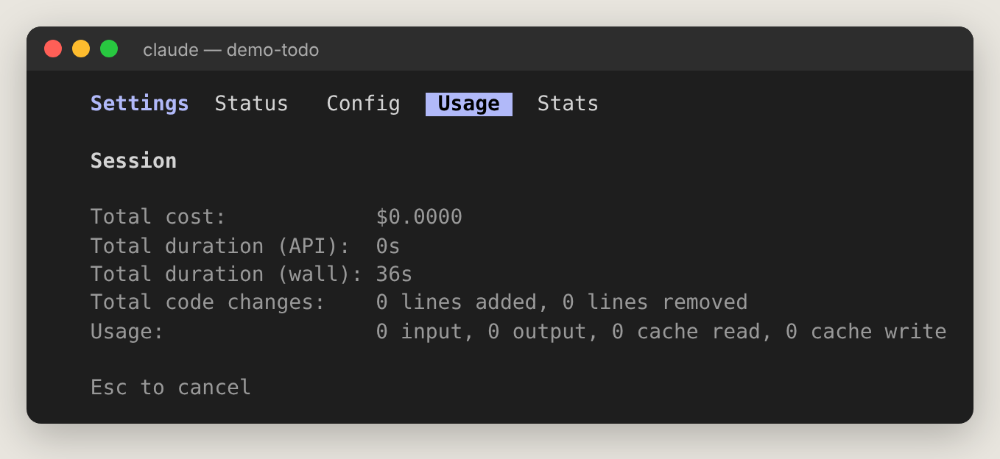

Usage 顯示：總花費、API 時間、實際經過時間、程式碼增刪行數、token 用量（輸入、輸出、快取讀寫）。

## 7.3 Config 分頁：逐項說明

下表依面板上的順序排列。「設定檔寫法」可以直接貼進 `~/.claude/settings.json` 的大括號裡。

### 對話與 context

| 面板選項 | 預設 | 說明與何時調整 | 設定檔寫法 |
| --- | --- | --- | --- |
| **Auto-compact** | true | context 快滿時自動把舊對話摘要壓縮。**建議保持開啟**，關掉後 context 滿了會直接出錯。 | `"autoCompactEnabled": true` |
| **Idle compaction** | true | 超過 20 萬 token 的長對話閒置約 54 分鐘時，先壓縮再讓快取過期，回來時比較省額度。不希望它自動摘要就關掉。 | `"idleCompaction": false` |
| **Continue automatically at usage limit** | true | 訂閱額度用完時，等額度重置後自動繼續剛才的任務。關掉則跳出選單讓你選。 | `"autoContinueAtUsageLimit": true` |
| **Switch models when a message is flagged** | Switch automatically | 訊息被安全機制標記時：自動換模型繼續，或「Ask each time」每次問你。 | `"switchModelsOnFlag": false`（= 每次問） |
| **Thinking mode** | true | 延伸思考。Opus 5.5 等新模型無法關閉（畫面會顯示「Thinking can't be turned off」）。 | `"alwaysThinkingEnabled": true` |
| **Prompt suggestions** | true | 回合結束後在輸入框顯示灰色的「你可能想說的下一句」，按 <kbd>Tab</kbd> 採用。 | `"promptSuggestionEnabled": false` |
| **Session recap** | true | 離開 5 分鐘以上回來時，顯示期間發生的事。 | `"awaySummaryEnabled": false` |
| **Rewind code (checkpoints)** | true | 改檔前存快照，讓 `/rewind` 能還原程式碼。**建議保持開啟**。 | `"fileCheckpointingEnabled": true` |

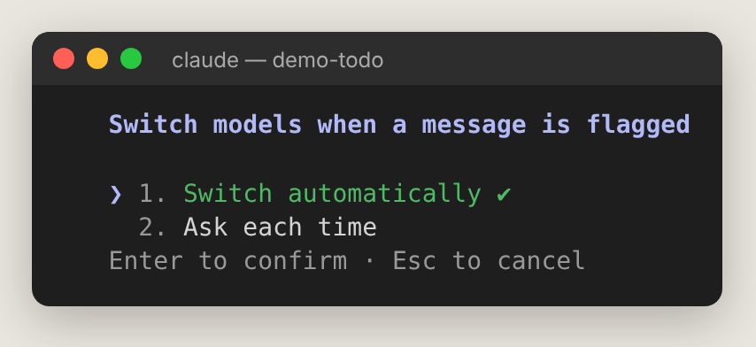

### 多代理工作流程

| 面板選項 | 預設 | 說明 | 設定檔寫法 |
| --- | --- | --- | --- |
| **Dynamic workflows** | true（Pro 需手動開） | 允許 Claude 寫腳本一次指揮多個子代理處理大任務（第 13 章）。 | `"enableWorkflows": true` |
| **Ultracode keyword trigger** | true | 提示中出現 `ultracode` 就啟動工作流程。常誤觸就關掉。 | `"workflowKeywordTriggerEnabled": false` |
| **Dynamic workflow size** | medium | 工作流程的代理數量建議：small（&lt;5）、medium（&lt;10）、large（&lt;50）、unrestricted。越大越耗額度。 | `"workflowSizeGuideline": "small"` |
| **Artifacts** | true | 允許 Claude 把成果發布成可分享的網頁（artifact）。 | `"enableArtifact": false` |

### 顯示

| 面板選項 | 預設 | 說明 | 設定檔寫法 |
| --- | --- | --- | --- |
| **Show tips** | true | 工作中 spinner 下方的小提示。 | `"spinnerTipsEnabled": false` |
| **Reduce motion** | false | 減少動畫（對眼睛敏感或用螢幕閱讀器時）。 | `"prefersReducedMotion": true` |
| **Verbose output** | false | 永遠顯示完整工具輸出（等於一直開著 <kbd>Ctrl+O</kbd>）。 | `"verbose": true` |
| **Terminal progress bar** | true | 在支援的終端機分頁上顯示進度。 | `"terminalProgressBarEnabled": false` |
| **Show turn duration** | true | 回合結束顯示「Cooked for 12s」。 | `"showTurnDuration": false` |
| **Time format** | auto | 時間格式：auto、12-hour、24-hour、24-hour-utc。 | `"timeFormat": "24-hour"` |
| **Theme** | Dark mode | 配色主題（見下圖）。 | `"theme": "light"` |
| **Output style** | default | 回覆風格（見下圖與第 12 章）。 | `"outputStyle": "Concise"` |
| **Language** | English | Claude 回覆與語音的語言。**想要中文回覆就設這個**。 | `"language": "繁體中文"` |
| **Show PR status footer** | true | 底部顯示目前分支 PR 的審查狀態。 | `"prStatusFooterEnabled": false` |

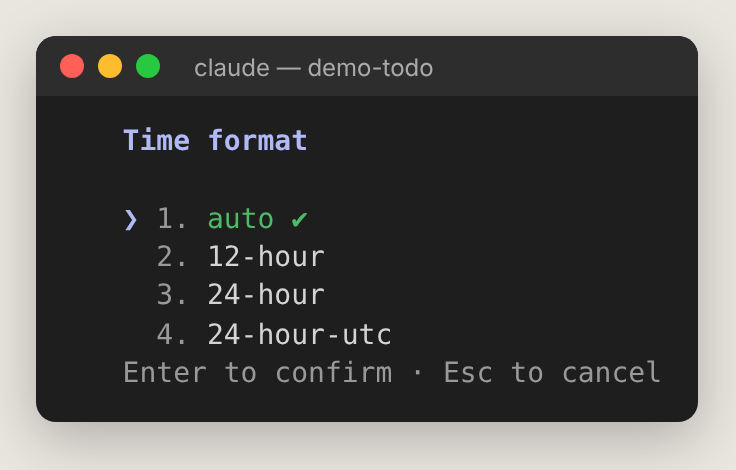

**Theme**：包含自動跟隨終端機、深色、淺色、色盲友善、只用 ANSI 顏色等版本，下方即時預覽 diff 顏色；<kbd>Ctrl+T</kbd> 可關閉語法上色。

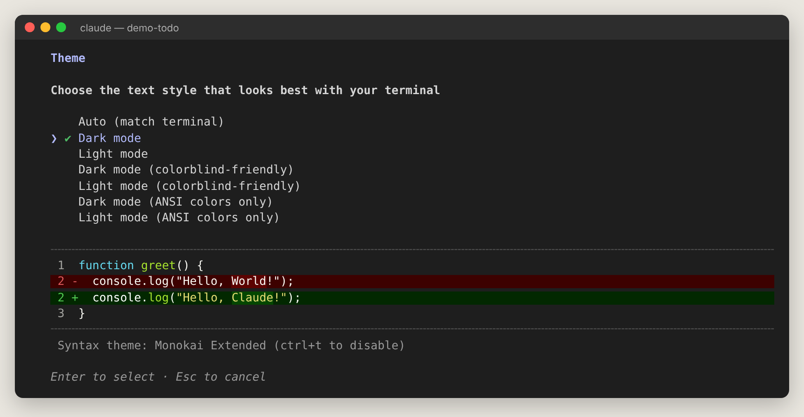

**Output style**：

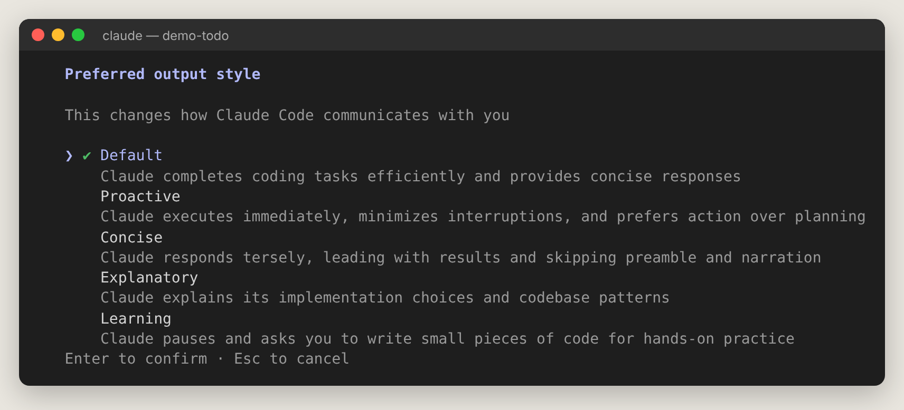

| 風格 | 適合 |
| --- | --- |
| Default | 一般使用 |
| Proactive | 想讓 Claude 少問、直接做 |
| Concise | 嫌回覆太長 |
| Explanatory | 想邊做邊學、了解為什麼這樣寫 |
| Learning | 想練功：Claude 會留一小段程式讓你自己寫 |

**Language**：直接輸入語言名稱，例如「繁體中文」「Japanese」，留空則為英文：

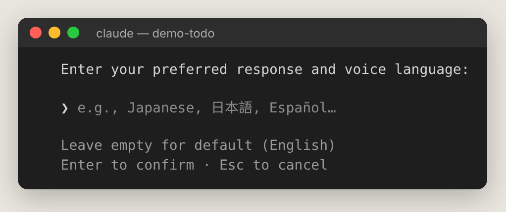

### 權限與工作方式

| 面板選項 | 預設 | 說明 | 設定檔寫法 |
| --- | --- | --- | --- |
| **Default permission mode** | Manual（互動模式實際預設為 Auto） | 新 session 起始權限模式。按 Enter 循環切換。 | `"permissions": { "defaultMode": "acceptEdits" }` |
| **Use auto mode during plan** | true | Plan 模式中，讓分類器自動核准唯讀類 shell 指令；關掉改為每次問。 | `"useAutoModeDuringPlan": false` |
| **Worktree base ref** | fresh | 新 worktree 從哪裡分出：fresh（遠端預設分支最新版）或 head（你目前的本地 HEAD）。 | `"worktree": { "baseRef": "head" }` |
| **Respect .gitignore in file picker** | true | `@` 檔案選單是否隱藏 .gitignore 裡的檔案。 | `"respectGitignore": false` |
| **Editor mode** | normal | 輸入框按鍵：normal 或 vim。 | `"editorMode": "vim"` |
| **Question auto-continue timeout** | never | Claude 問你選擇題時，閒置多久自動以已選答案繼續：60s、5m、10m、never。 | `"askUserQuestionTimeout": "5m"` |
| **Dialog expiry** | default（5 分鐘） | 轉到手機等遠端裝置的確認框，多久沒回就取消。 | `"dialogExpiry": "10m"` |
| **Messages from your other sessions** | default | 其他 session 傳來的訊息：accept（直接收）、hold（暫存待審）、refuse（拒收）。 | `"crossSessionInbound": "hold"` |
| **Model** | Default (recommended) | 預設模型（同 `/model`）。 | `"model": "sonnet"` |

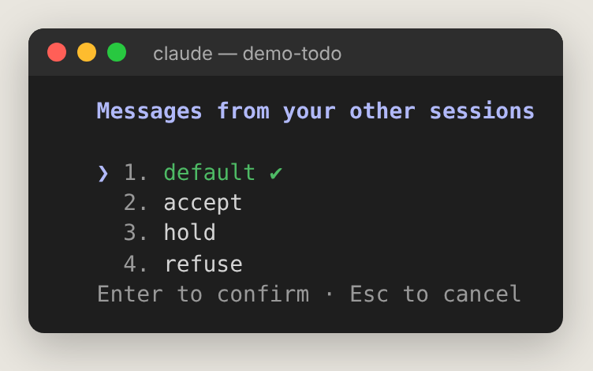

### 複製、捲動與 Agent view

| 面板選項 | 預設 | 說明 | 設定檔寫法（~/.claude.json 或 settings） |
| --- | --- | --- | --- |
| **Skip the /copy picker** | false | `/copy` 直接複製整段回覆，不跳出區塊選擇器。 | `"copyFullResponse": true` |
| **Copy on select** | true | 滑鼠選取文字即自動複製（全螢幕模式）。 | `"copyOnSelect": false` |
| **Auto-scroll** | true | 全螢幕模式自動捲到最新輸出。 | `"autoScrollEnabled": false` |
| **Open agents view by default** | false | 只打 `claude` 時直接開 Agent view。 | `"defaultToAgentsView": true` |
| **← opens agents** | true | 空白輸入按 <kbd>←</kbd> 開 Agent view。常誤觸就關掉。 | `"leftArrowOpensAgents": false` |
| **Show last response in external editor** | false | 按 <kbd>Ctrl+G</kbd> 開編輯器時，附上 Claude 上一則回覆（註解形式）方便引用。 | `"externalEditorContext": true` |

### 更新、通知與整合

| 面板選項 | 預設 | 說明 | 設定檔寫法 |
| --- | --- | --- | --- |
| **Auto-update channel** | latest | latest（新功能最快）或 stable（約晚一週，跳過有問題的版本）。 | `"autoUpdatesChannel": "stable"` |
| **Local notifications** | Auto | 任務完成或需要你時的通知方式：終端機鈴聲、iTerm2、Kitty、Ghostty 通知或關閉。 | `"preferredNotifChannel": "terminal_bell"` |
| **Auto-connect to IDE (external terminal)** | false | 在外部終端機啟動時，自動連到正在執行的 VS Code／JetBrains。 | `"autoConnectIde": true` |
| **Claude in Chrome enabled by default** | false | 每個 session 都啟用 Chrome 瀏覽器整合。 | `"claudeInChromeDefaultEnabled": true` |
| **Use custom API key** | （有設 API key 時才出現） | 是否使用環境變數中的 `ANTHROPIC_API_KEY`。 | — |
| **Project instructions** | claude-md-or-agents-md | 要讀 CLAUDE.md、AGENTS.md 或兩者（第 11 章）。 | 見下方 |

切到 stable 頻道時，會問你要「允許降版」還是「停在目前版本直到 stable 追上」：

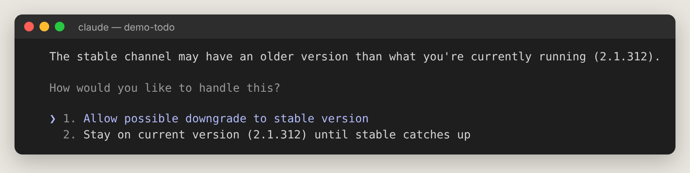

**Project instructions**：

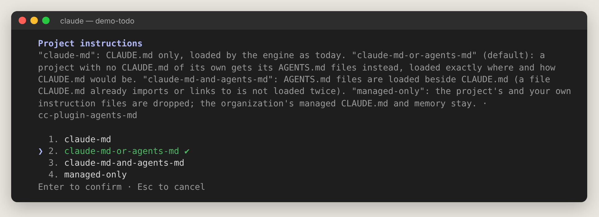

| 值 | 讀哪些檔 |
| --- | --- |
| claude-md | 只讀 CLAUDE.md |
| claude-md-or-agents-md（預設） | 有 CLAUDE.md 就讀它，沒有才讀 AGENTS.md |
| claude-md-and-agents-md | 兩者都讀 |
| managed-only | 只讀公司統一下發的指示 |

設定檔寫法：

```json
{
  "pluginConfigs": {
    "cc-plugin-agents-md@builtin": { "options": { "instructionFiles": "claude-md-and-agents-md" } }
  }
}
```

## 7.4 其他設定對話框

### `/model`：選模型

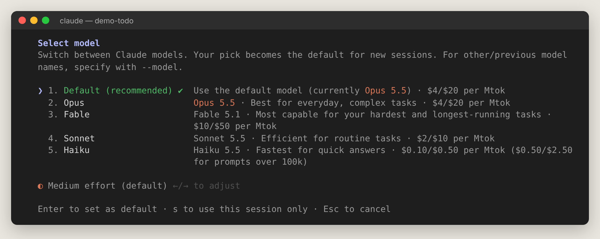

- 上下鍵選模型，<kbd>←</kbd>/<kbd>→</kbd> 調 effort。
- <kbd>Enter</kbd> 設為預設（之後新 session 也用它）；<kbd>s</kbd> 只用於本次 session。
- 每個模型旁直接標示價格（每百萬 token 輸入／輸出）。

### `/effort`：推理強度

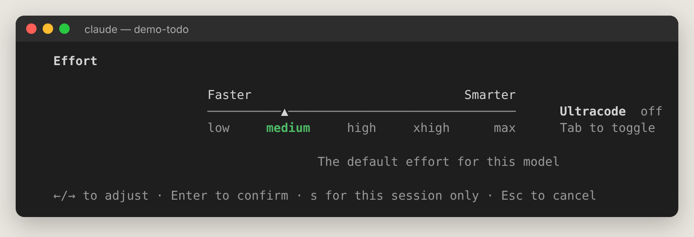

- 左右鍵在 low、medium、high、xhigh、max 之間調整；<kbd>Tab</kbd> 切換 Ultracode。
- <kbd>s</kbd> 只用於本次 session。

### `/permissions`：權限規則

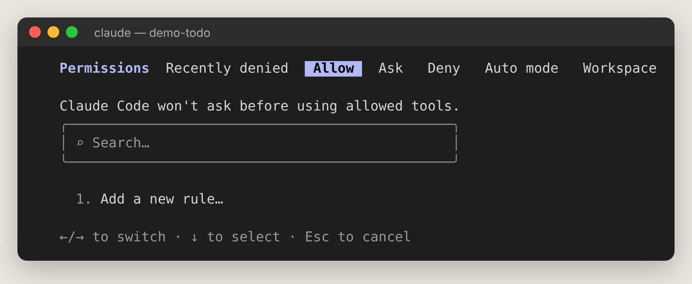

分頁：Recently denied（Auto mode 最近擋下的動作，可重試）、Allow、Ask、Deny、Auto mode（分類器規則）、Workspace（工作目錄）。選「Add a new rule…」新增規則（第 9 章）。

### `/memory`：記憶

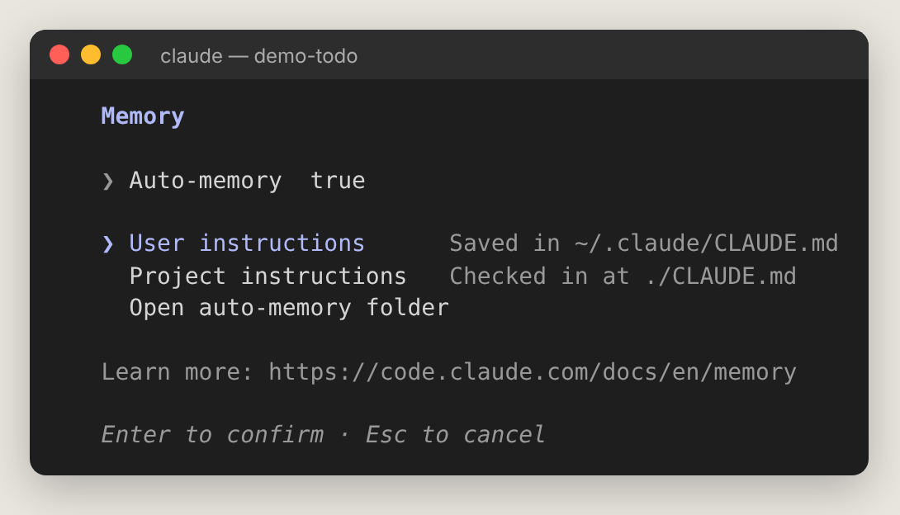

開關 Auto-memory、編輯個人 `~/.claude/CLAUDE.md` 或專案 `./CLAUDE.md`、打開自動記憶資料夾。

### `/hooks`、`/skills`、`/plugin`、`/sandbox`

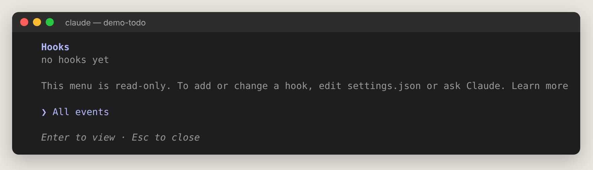

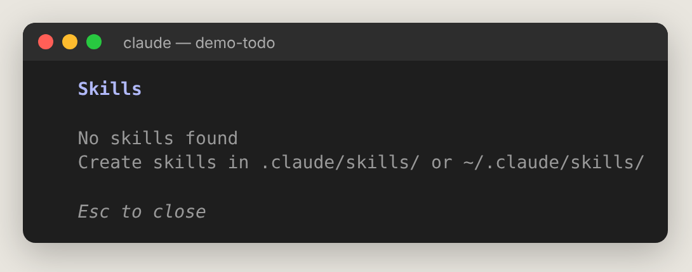

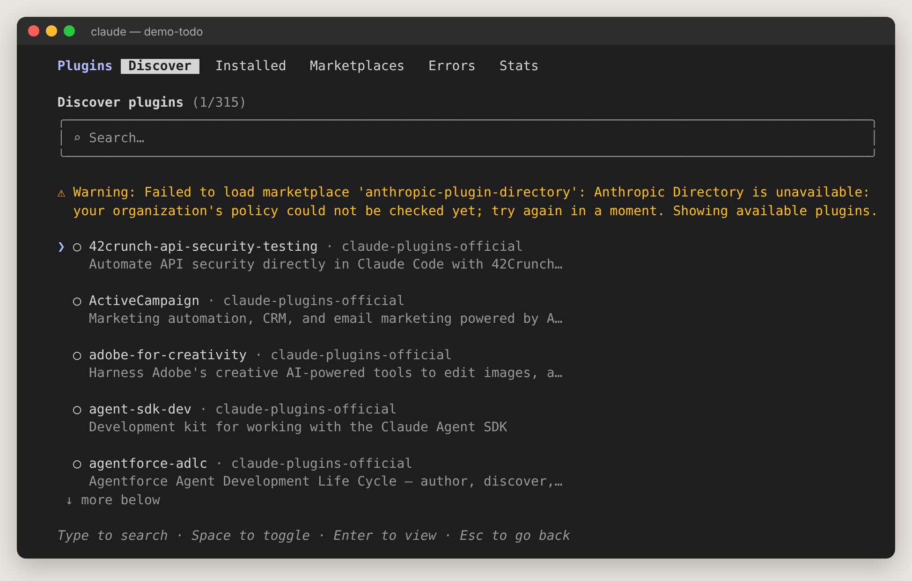

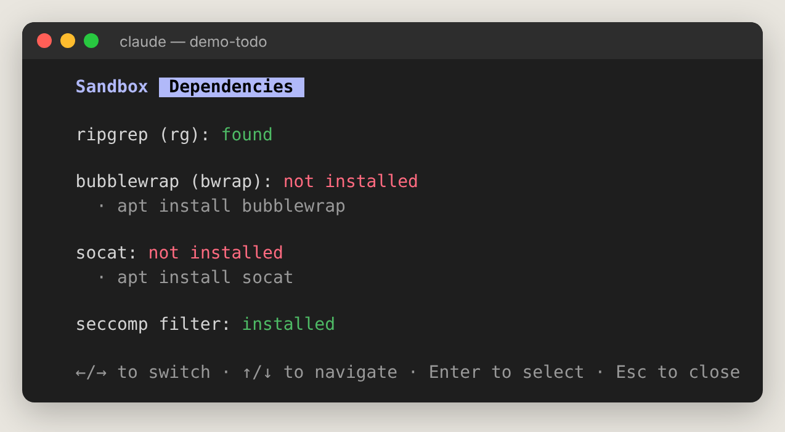

這些分別在第 12、9 章詳細介紹。

## 7.5 我該先改哪些設定？（新手建議）

| 需求 | 建議設定 |
| --- | --- |
| 想要中文回覆 | Language → `繁體中文` |
| 想要邊做邊學 | Output style → Explanatory |
| 嫌 Claude 囉嗦 | Output style → Concise |
| 怕 Claude 亂改 | Default permission mode → Manual |
| 想穩定不想踩新版 bug | Auto-update channel → stable |
| 眼睛容易累 | Theme → Light／Reduce motion → true |
