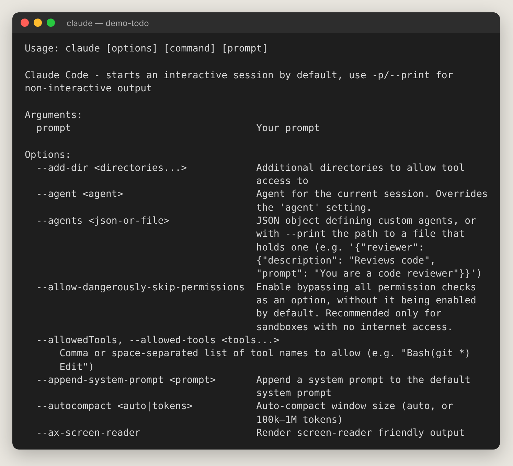

# 第 14 章　命令列參數與環境變數

## 14.1 常用啟動方式

```bash
claude                               # 互動模式
claude "修好 build 錯誤"               # 帶第一句話啟動
claude -p "解釋這個函式"               # 非互動：印出結果就結束
cat logs.txt | claude -p "分析錯誤"    # 把內容傳給 Claude
claude -c                            # 接續這個資料夾最近的對話
claude -r                            # 從清單挑舊對話
claude -r "登入功能"                   # 用名稱恢復
claude -n "新功能"                     # 為 session 命名
claude -w feature-auth               # 在獨立 git worktree 中啟動
claude --bg "調查 flaky test"          # 直接開背景 session
claude --cloud "修登入 bug"            # 開雲端 session
```

`claude --help` 的開頭：



## 14.2 子指令

| 指令 | 用途 |
| --- | --- |
| `claude update` | 更新 |
| `claude install stable`／`latest`／版本號 | 安裝指定版本或頻道 |
| `claude doctor` | 診斷安裝與設定（唯讀） |
| `claude auth login`／`logout`／`status` | 登入管理 |
| `claude setup-token` | 產生給 CI 用的長效 token |
| `claude agents` | Agent view |
| `claude attach`／`logs`／`stop`／`respawn`／`rm` | 管理背景 session |
| `claude mcp add`／`list`／`get`／`remove`／`login` | MCP 管理 |
| `claude plugin install`／`validate`／`eval` | Plugin 管理 |
| `claude auto-mode defaults`／`config`／`reset` | 檢視 Auto mode 規則 |
| `claude ultrareview 1234` | 在 CI 中跑深度審查 |
| `claude remote-control` | 伺服器模式的遠端控制 |
| `claude import cursor` | 從其他工具匯入設定 |
| `claude purge 路徑 --dry-run` | 刪除某專案在這台電腦的 Claude 資料 |

## 14.3 常用參數

| 參數 | 說明 | 例子 |
| --- | --- | --- |
| `--model` | 本次模型 | `--model sonnet` |
| `--effort` | 本次推理強度 | `--effort high` |
| `--permission-mode` | 起始權限模式 | `--permission-mode plan` |
| `--allowedTools`／`--disallowedTools` | 允許／禁止的工具 | `--allowedTools "Bash(git *)" "Read"` |
| `--add-dir` | 額外可存取資料夾 | `--add-dir ../shared` |
| `--settings` | 本次額外設定 | `--settings '{"outputStyle":"Concise"}'` |
| `--append-system-prompt` | 附加系統指示 | `--append-system-prompt "一律用繁體中文"` |
| `--output-format` | `-p` 的輸出格式：text、json、stream-json | `-p "..." --output-format json` |
| `--max-turns`／`--max-budget-usd` | 限制回合數／花費（`-p`） | `--max-budget-usd 3` |
| `--mcp-config` | 載入 MCP 設定檔 | `--mcp-config ./mcp.json` |
| `--plugin-dir` | 本次載入開發中的 plugin | `--plugin-dir ./my-plugin` |
| `--agent` | 用某個子代理當主代理 | `--agent code-reviewer` |
| `--safe-mode` | 停用所有自訂，排查問題 | `claude --safe-mode` |
| `--bare` | 最精簡模式，腳本啟動更快 | `claude --bare -p "..."` |
| `--debug` | 除錯輸出 | `--debug='mcp'` |
| `--chrome`／`--ide` | 連 Chrome／IDE | `claude --chrome` |
| `--remote-control`（`--rc`） | 開放遠端控制 | `claude --rc` |
| `--dangerously-skip-permissions` | 完全不問（只在隔離環境） | — |

## 14.4 常用環境變數

可以在終端機 `export 變數=值`（Windows PowerShell：`$env:變數="值"`），或寫進設定檔的 `"env"`：

```json
{ "env": { "CLAUDE_CODE_SUBAGENT_MODEL": "sonnet" } }
```

| 變數 | 用途 | 例子 |
| --- | --- | --- |
| `ANTHROPIC_MODEL` | 本次模型（優先於設定檔） | `opus` |
| `ANTHROPIC_DEFAULT_MODEL` | 新 session 預設模型 | `sonnet` |
| `ANTHROPIC_DEFAULT_OPUS_MODEL` 等 | 改變 opus／sonnet／haiku／fable 別名指向 | `claude-opus-5-5` |
| `CLAUDE_CODE_EFFORT_LEVEL` | 推理強度 | `high` |
| `CLAUDE_CODE_SUBAGENT_MODEL` | 子代理用的模型 | `sonnet` |
| `CLAUDE_CODE_AUTO_COMPACT_WINDOW` | 自動壓縮門檻 | `500000` |
| `CLAUDE_CODE_DISABLE_1M_CONTEXT` | 強制 20 萬 context | `1` |
| `MAX_THINKING_TOKENS` | 設 0 關閉思考（可關閉的模型） | `0` |
| `CLAUDE_CODE_FORK_SUBAGENT` | 設 0 關閉 fork 子代理 | `0` |
| `CLAUDE_CODE_DISABLE_AUTO_MEMORY` | 關閉自動記憶 | `1` |
| `CLAUDE_CODE_DISABLE_WORKFLOWS` | 關閉動態工作流程 | `1` |
| `CLAUDE_CODE_DISABLE_AGENT_VIEW` | 關閉 Agent view | `1` |
| `CLAUDE_CODE_DISABLE_FAST_MODE` | 關閉 Fast mode | `1` |
| `CLAUDE_CODE_DISABLE_FILE_MENTIONS` | `@` 只給路徑、不直接塞檔案內容 | `1` |
| `CLAUDE_CODE_NEW_INIT` | `/init` 使用互動完整流程 | `1` |
| `CLAUDE_CONFIG_DIR` | 改變 `~/.claude` 的位置 | `~/work-claude` |
| `MCP_TIMEOUT`／`MCP_TOOL_TIMEOUT` | MCP 啟動／工具逾時（毫秒） | `30000` |
| `MAX_MCP_OUTPUT_TOKENS` | MCP 輸出上限（預設 25000） | `50000` |
| `ANTHROPIC_API_KEY` | 用 API key 驗證 | — |
| `ANTHROPIC_BASE_URL` | 經公司閘道連線 | — |
| `CLAUDE_CODE_USE_BEDROCK`／`CLAUDE_CODE_USE_VERTEX` | 使用 AWS／Google Cloud | `1` |
| `DISABLE_TELEMETRY` | 關閉遙測 | `1` |
| `DISABLE_AUTOUPDATER` | 關閉自動更新 | `1` |
| `CLAUDE_CODE_DISABLE_NONESSENTIAL_TRAFFIC` | 關閉非必要網路流量 | `1` |
